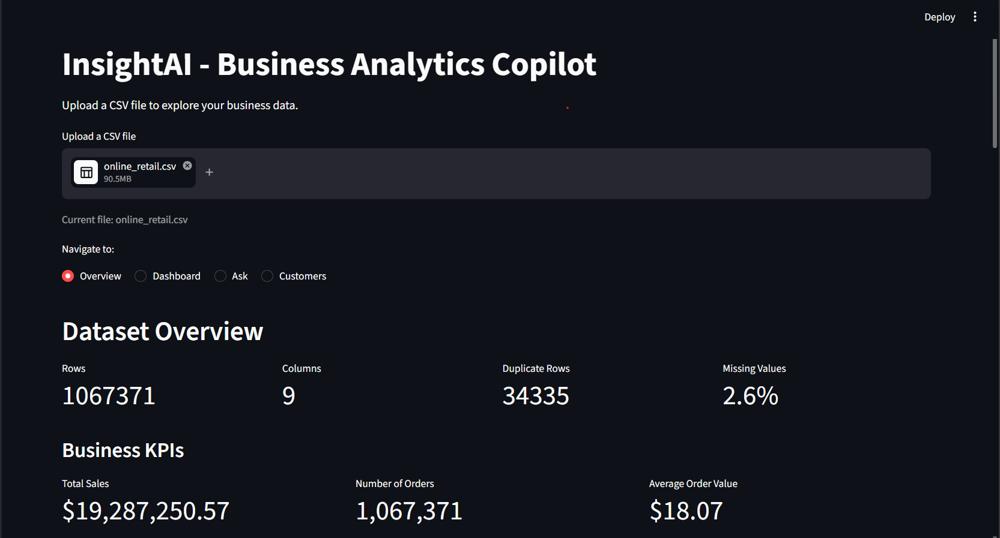
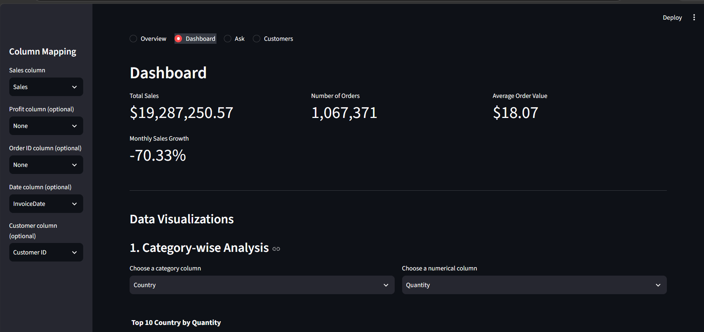

# InsightAI - Business Analytics Copilot

## What is InsightAI
InsightAI is an interactive business analytics web application designed to help users explore and evaluate business datasets without writing manual code.
It provides automated data quality profiling, core commercial KPI calculations, and interactive visual dashboards from uploaded CSV files.
The platform also features customer segmentation using RFM analysis to translate raw transactional data into actionable business strategies.

## Features so far
- **Flexible Data Ingestion:** Robust CSV file upload supporting multiple encodings (`utf-8`, `latin-1`) with automated column guessing.
- **Data Quality Profiling:** Instant overview of dataset dimensions, duplicate row counts, missing value breakdowns, column data types, and IQR-based outlier detection.
- **Executive Business KPIs:** Automated computation of Total Sales, Total Profit, Profit Margin, Total Orders, Average Order Value (AOV), and Month-over-Month Sales Growth.
- **Interactive Visualizations:** High-performance Plotly charts including Top-N Category Bar Charts, Monthly Sales Trend Lines, Correlation Scatter Plots, and Distribution Histograms.
- **Customer RFM Segmentation:** Recency, Frequency, and Monetary scoring (1–5 quintiles) classifying customers into actionable tiers (*Champions*, *Loyal*, *Potential*, *At Risk*) with CSV export capability.

## Screenshots

*Dataset overview and data quality profiling*


*Interactive KPI dashboard and monthly trends*

## How to run it locally
Ensure you have Python 3.9+ installed. Run the following commands in your terminal:

```bash
# 1. Clone the repository
git clone https://github.com/<your-username>/InsightAI.git
cd InsightAI

# 2. Create and activate a virtual environment
python -m venv venv

# On Windows:
venv\Scripts\activate

# On macOS/Linux:
# source venv/bin/activate

# 3. Install required dependencies
pip install -r requirements.txt

# 4. Launch the application
streamlit run app.py
```

## Project structure
- `app.py`: Main Streamlit application handling UI layout, sidebar configuration, user navigation (Overview, Dashboard, Ask, Customers), and session state.
- `analysis.py`: Analytical engine providing data loading (`load_csv`), quality profiling (`profile`), commercial metrics (`kpis`), column inference (`guess_column`), and RFM segmentation (`rfm`).
- `charts.py`: Visualization module housing reusable Plotly chart functions (`top_n_bar`, `trend_line`, `scatter`, `histogram`) with sampling optimizations for large datasets.
- `requirements.txt`: Specifies production dependencies (`streamlit`, `pandas`, `plotly`).
- `docs/`: Contains project documentation assets and application screenshots.

## Tech used
- **Python:** Core programming and analytical scripting.
- **Streamlit:** Interactive web application framework and reactive UI.
- **Pandas:** Data loading, data cleaning, aggregation, and statistical transformations.
- **Plotly Express:** Fast, interactive visual charts and graphs.
- **Git & GitHub:** Version control and repository hosting.

## Known limitations
1. **In-Memory Data Scaling:** Because data processing runs purely in-memory with Pandas, uploading extremely large files (e.g., >200MB or multi-million rows) can cause high memory usage on standard machines.
2. **Heuristic Column Matching:** Column guessing relies on keyword pattern matching; unconventional or non-English column names require manual selection through the sidebar.
3. **Quantile Discretization in RFM:** RFM scoring uses quintiles (`pd.qcut`), which assumes an evenly distributed customer distribution; datasets with heavy ties or very few repeat purchases can produce skewed segment boundaries.